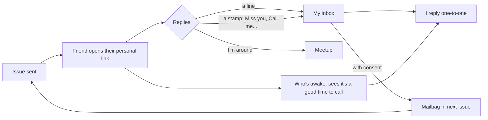

# Postcards from Shashank: product vision

A short, beautifully designed postcard sent every season to friends around the world. It shares what I've been up to, and its main job is to get friends replying.

Prototype of issue No. 01: [`prototype/issue-01.html`](../prototype/issue-01.html)

---

## 1. The goal, and how we'll know it works

**Goal:** keep real friendships going across countries and time zones.

A newsletter alone only tells friends what I'm doing. Staying in touch means they reply and conversations start. So success is measured in conversations, not opens.

| Metric | Target |
|---|---|
| Friends who reply with anything (a line, a stamp, a voice note) | 30% or more per issue |
| One-to-one conversations started by an issue | 5 or more |
| Meetups arranged through "Next stop" | 1 or more per year |
| Issues sent on schedule | 4 a year, for 2+ years |
| Friends who ask to stop receiving it | About zero |

No open-tracking pixels. They're unreliable now, since Apple Mail pre-loads images, and they feel wrong between friends.

---

## 2. What's out there

| Category | Examples | Good at | Weak for this goal | Idea we borrow |
|---|---|---|---|---|
| Creator newsletters | Substack, Buttondown, Ghost, beehiiv, Kit | Reliable email, archives, easy editors | Built to grow a public audience. Templated look, video only as links, replies are one email at a time | Use one as the email pipe (Buttondown is free up to 100 subscribers) |
| Group newsletters | Letterloop | Everyone answers the same prompts, compiled into one email, no app | It's a collage of everyone, not your voice or your design | Prompt questions; a friend-written section |
| Private photo circles | Retro, Locket, BeReal, Google/iCloud shared albums | Low effort, frequent, intimate | Need an app or one phone ecosystem. Feeds scroll away and don't tell a story | Retro's reciprocity: you see more when you share |
| Async voice/video | Marco Polo, WhatsApp voice notes | Feels like a real conversation | One-to-one or small groups, no archive | Voice-note replies |
| Slow and tangible | Slowly (letters "delivered" based on distance), Touchnote (phone photos printed as real postcards), Storyworth (weekly questions bound into a book) | Ritual, anticipation, keepsakes | Not designed for one-to-many life updates | The postcard metaphor, distance as a feature, a printed yearbook |
| Personal sites | /now pages, Postcard (postcard.page), Bear Blog | You own it | Passive; nothing nudges anyone to respond | Own the archive |
| Personal CRMs | Dex, Clay, Monica | Remind you who you haven't talked to | Private tools; friends never see anything | "You haven't heard from Lena in two issues" nudges for the author |

TinyLetter, the classic tool for small personal newsletters, shut down in 2024, and nothing has replaced it for this use.

### The gap

No existing product combines all five of these:

1. Your own voice and design, not a template
2. Rich media, including video
3. Nothing for friends to install, no accounts, and it works in whatever chat app they use
4. Built-in, low-effort reasons to reply
5. An archive you own

### What shaped the design

1. **A broadcast doesn't keep you in touch.** Every design decision should lower the cost of replying.
2. **The author is the bottleneck.** Personal newsletters usually stop around issue 3, so each issue has to take under an hour.
3. **Friends use different apps.** WhatsApp leads in most countries, but Japan uses LINE, South Korea KakaoTalk, China WeChat, and Messenger leads in places like Australia and Canada. The issue is a web link that works in any app, with email alongside.
4. **Distance is the emotional core.** Lean into it with postmarks, local times, "who's awake" and "next stop".
5. **The archive becomes a keepsake.** After a few years the back issues are a visual record of a life, and of a friendship group.

---

## 3. Product principles

1. **A postcard, not a blog.** About three minutes to read, five or six sections.
2. **Every issue asks for something back,** and replying can take a single tap.
3. **Nothing to install.** No accounts; works on any phone and on slow connections.
4. **An hour to make,** start to finish.
5. **Private by default.**
6. **Built to last.** Plain files I own; no lock-in.

---

## 4. Anatomy of an issue

**Core, in every issue:**

| Section | What it is |
|---|---|
| Cover | A large-letter "Greetings from ___" postcard (wherever I am this season, home included) with a postmark and the issue's stamp |
| Letter | 3–5 sentences, personally addressed ("Dear Priya,") |
| Lately | Three short updates with a tag each (work, home, body, travel…) |
| The moment | One photo or a video of 30 seconds or less, plus the story behind it |
| Your turn | One easy question, a reply box, and one-tap rubber-stamp reactions |

**Rotating, one or two per issue:**

| Section | What it is |
|---|---|
| Camera roll | 4–6 polaroids you can swipe through and tap to enlarge |
| Currently | Reading / listening / cooking / obsessed with, styled as a customs declaration form |
| Next stop | Upcoming travel as a boarding pass, with "I'm around" / "Not this time" buttons |
| Mailbag | Friends' answers to the last question, quoted only with their OK |
| Friend takeover | One friend writes a section |

**Always in the footer:**
- **Who's awake:** a world map of friends with live local times and "good time to call" chips
- **Stamp album:** the archive, one stamp per issue

---

## 5. The reply loop

This is what makes it two-way.

- **Make replying effortless.** One sentence is enough, and stamps take a single tap. Replying to the email works too.
- **Show that replies matter.** The Mailbag puts friends in the next issue, so they also see each other.
- **Get from broadcast to conversation.** "Who's awake" and "Call me" stamps push toward one-to-one calls, which is the real goal.
- **Meet in person.** "Next stop" turns travel plans into meetups.
- **Personal links.** Each friend gets their own link. It powers the greeting, their pin on the map, and the From line on their reply.

---

## 6. The author side (keeping it under an hour)

- **During the season:** keep a "Postcard drafts" photo album and a running notes file on my phone.
- **Two weeks before issue day:** get a reminder (Claude can schedule this).
- **Issue day:** hand Claude the bullet points and photos, get back a draft issue in my voice, edit it, publish.
- **Friend list:** one private file with name, city, time zone, email, preferred chat app and birthday.
- **After sending:** read replies in one inbox, and see who I haven't heard from in two issues so I can message them personally.

---

## 7. Design direction: Airmail

- **Palette:** pale-blue airmail paper, fountain-pen navy, red-and-blue airmail chevrons, marigold stamp yellow. Dark mode is "night mail" navy.
- **Type:** a chunky slab serif (Alfa Slab One) for the large-letter cover, Literata for reading, Kalam handwriting for personal touches, and Courier Prime for postal labels.
- **Postal objects:** the "Greetings from" postcard, postmark, perforated stamp, polaroids, CN22 customs form, boarding pass, rubber stamps, the back of a postcard, and a stamp album.
- **Changes each issue:** the cover city and its illustration or photo, the stamp art, the photos. Everything else stays fixed, so each issue is recognisably part of the series.

---

## 8. How it works technically

All of this is free at the size of a friend group. The table shows what was built; [`SETUP.md`](SETUP.md) has the details.

| Piece | Built as | Why |
|---|---|---|
| Site | A dependency-free static build (`scripts/build.mjs`); one folder per issue (`issue.json` + media) and a shared renderer used by both the build and the Studio preview | Full design control, plain files, nothing to maintain |
| Hosting | GitHub Pages, deployed by GitHub Actions on every push to `master` | Free, and the repo is the whole system |
| Editor | The Studio at `/studio/`: form editor with live preview, in-browser photo compression, one commit per save through the GitHub Git Data API, deploy progress, and a share panel | Under an hour per issue, from any device, with no app to install |
| Video | Short MP4s committed with the issue (poster frame and duration made in the browser), or unlisted YouTube for anything longer | Simple; loads only when played |
| Replies and stamps | `wa.me` and `mailto` links filled in with the friend's answer, stamps, consent and name | No server, no accounts, and replies land where conversations already happen |
| Personal links | `?to=Name`, matched against the friend list | Greeting, map pin and From line; a greeting, not a login |
| Email and chat | The Studio writes the WhatsApp message, a copyable designed email, a BCC `mailto` and a personal link per friend; friends' addresses stay in the browser | Reaches friends on any app; no mailing service needed to start |
| Privacy | Unlisted URLs, `noindex` and `robots.txt` | Low friction; anyone with a link can read it |

**Weight budget:** images in AVIF/WebP at 200 KB or less each, and the issue page under 2 MB before video. Videos get poster frames and load only when played.

---

## 9. Roadmap

| Phase | Scope |
|---|---|
| **0. Prototype** (done) | The design, with sample content |
| **1. First real issue** (built) | Static site on GitHub Pages, the Studio, friend list, WhatsApp/email replies, personal links, live "Who's awake", "I'm around" |
| **2. Two-way** (next season) | Stored replies and stamps in one inbox, Mailbag filled from replies with consent, "haven't heard from" nudges, a personal domain |
| **3. Keepsakes** (end of year one) | Printable yearbook or print-on-demand zine, one physical postcard per friend each year, voice-note replies |

---

## 10. Risks

| Risk | Mitigation |
|---|---|
| I stop after three issues | Seasonal cadence, a one-hour template, a reminder, Claude drafting |
| Nobody replies | One easy question, one-tap stamps, the Mailbag showing replies matter, personal greeting |
| It reads like a brag reel | Keep it short, include small and honest moments, ask about them |
| It lands in spam | Send from my own domain through Buttondown; ask friends to reply once |
| Privacy (other people's faces, where I am) | Unlisted + `noindex`, ask before posting friends' photos, post locations after leaving |
| Videos are too heavy | Streaming host with adaptive quality, clips of 30 seconds or less, poster frames |

---

## 11. Decisions

Settled in October 2026:

1. **Name:** "Postcards from Shashank".
2. **Cadence:** seasonal, four a year.
3. **Privacy:** unlisted link with `noindex`; no PIN gate.
4. **Delivery:** both. Email and WhatsApp carry the link, and friends visit the site for each new issue.
5. **Design:** postcard, editorial, scrapbook and film styles together, at the level of a high-end design studio.
6. **Editing:** a no-code editor, the Studio, on the site itself.
7. **Hosting:** GitHub Pages from this repository.

Still open: a personal domain (about $10 a year) would look nicer and helps if the email moves to a mailing service later.

---

## Sources

- [Letterloop](https://www.letterloop.co/) and its [family newsletter guide](https://www.letterloop.co/blog/making-a-family-newsletter-that-people-will-want-to-read)
- [Retro: TechCrunch, 2023](https://techcrunch.com/2023/07/07/retro-is-a-deeply-personal-photo-journaling-app-for-close-friends/), [Retro postcards and recaps](https://techcrunch.com/2023/12/07/retro-lets-you-create-recaps-of-your-most-memorable-photos-and-send-the-best-ones-as-postcards), [Dealroom profile](https://dealroom.co/companies/retro/)
- [Locket: TechCrunch, 2025](https://techcrunch.com/2025/08/06/photo-sharing-app-locket-is-banking-on-a-new-celebrity-focused-feature-to-fuel-its-growth)
- [Slowly: delivery time help article](https://help.slowly.app/hc/en-us/articles/115001835772-When-will-my-penpal-receive-my-letter)
- [Storyworth (Wikipedia)](https://en.wikipedia.org/wiki/Storyworth), [Touchnote review (Cool Tools)](https://kk.org/cooltools/?p=29801)
- [Postcard personal site tool (Product Hunt)](https://www.producthunt.com/posts/postcard-30b7e6cc-35e0-4648-9eee-0e3f60b86e86)
- [Messaging apps by country (Sinch)](https://sinch.com/blog/most-popular-messaging-apps-by-country/)
- [Buttondown pricing (Toolradar)](https://toolradar.com/tools/buttondown/pricing)
- [Cloudflare Zero Trust free plan](https://blog.cloudflare.com/teams-plans)
- [Writing newsletters that get replies (beehiiv)](https://create.beehiiv.com/p/how-to-write-newsletters-that-get-replies)
- Writers moving life updates from Instagram to email: [skyfi](https://skyfi.substack.com/p/the-new-heart-of-instagram), [austinsomewhere](https://austinsomewhere.substack.com/p/704-days-and-counting)
- [Private photo-sharing apps compared (Viallo, 2026)](https://www.viallo.app/blog/photo-sharing-app-friends)
